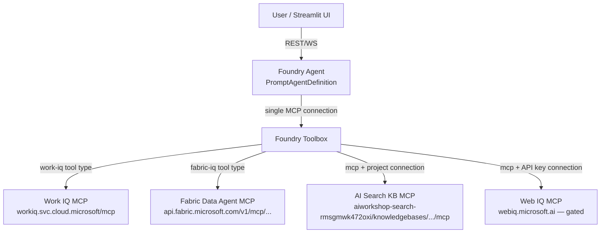

# All-Microsoft-IQ Demo — Research Report
### Fabric IQ · Foundry IQ · Web IQ · Work IQ — Unified Agent Architecture

---

## 1. Executive Summary

Microsoft's "IQ" family is a set of four complementary enterprise intelligence layers — **Work IQ** (Microsoft 365 collaboration signals), **Foundry IQ** (enterprise document/knowledge grounding via Azure AI Search), **Fabric IQ** (business/structured data over OneLake), and **Web IQ** (real-time web grounding)[^28]. All four now expose, or are actively migrating to, **Model Context Protocol (MCP)** endpoints, which makes them individually pluggable into a single AI agent[^24][^25]. The user already has concrete resources for three of the four: a working `workiq-demo` Python/Streamlit+FastAPI codebase, an Azure AI Search service (`aiworkshop-search-rmsgmwk472oxi`), and a published Fabric Data Agent endpoint. **Web IQ is currently gated** (waitlist/limited access to `@microsoft.com`/`@linkedin.com` accounts or approved enterprise customers)[^18], so the demo can be built end-to-end for the first three sources today, with Web IQ added as a mock/placeholder until access is granted. The recommended architecture is either (a) an **Azure AI Foundry Toolbox** that bundles all four MCP sources behind one governed endpoint, or (b) a single Foundry agent with **four separate `MCPTool` entries**, or (c) a **custom FastAPI orchestrator** that holds independent authenticated MCP client sessions per source — all three patterns are documented below with working code.

---

## 2. Confidence Assessment

| Confidence | Item |
|---|---|
| ✅ High (verified against actual code) | WorkIQ demo repo structure, auth flow (MSAL device code + auth code flow), REST + MCP tool surface — read directly from `/Users/microsoft/Desktop/experiment_project/workiq-demo` |
| ✅ High (verified against MS Learn docs) | Foundry IQ / Azure AI Search agentic retrieval pipeline (index → knowledge source → knowledge base → MCP → agent) |
| ✅ High (verified against MS Learn + official client repo) | Fabric Data Agent `aiassistant/openai` endpoint shape, auth scopes, deprecation date (Aug 26, 2026) |
| ⚠️ Medium (portal/product still evolving as of July 2026) | Foundry "Toolbox" feature exact SDK class names/signatures (`WorkIQTool`, `FabricIQTool`) — feature exists per docs but public SDK reference for exact constructor args wasn't independently confirmed |
| ⚠️ Medium | Web IQ exact MCP endpoint URL — inferred from REST pattern since real docs are gated behind login |
| 🔴 Low / Blocked | Whether the user's Entra tenant currently has Web IQ waitlist approval — **not verifiable from research; user must confirm** |

**Key assumption made:** Since Web IQ is inaccessible without an approval, this report treats it as a **fourth, optional tool** that should be stubbed/mocked in the initial demo and swapped in once real credentials are obtained.

---

## 3. What Each "IQ" Product Is

| Product | What It Grounds Agents In | Backbone Technology | MCP Endpoint Pattern |
|---|---|---|---|
| **Work IQ** | Microsoft 365 signals — mail, calendar, Teams, files, people, Copilot agents | Work IQ REST/MCP service | `https://workiq.svc.cloud.microsoft/mcp`[^1] |
| **Foundry IQ** | Enterprise documents/knowledge (SharePoint, Blob, OneLake, custom indexes) | Azure AI Search "Knowledge Base" (agentic retrieval) | `https://{search}.search.windows.net/knowledgebases/{kb}/mcp?api-version=2026-05-01-preview`[^9] |
| **Fabric IQ** | Structured business data — lakehouses, warehouses, Power BI semantic models, ontologies | Microsoft Fabric Data Agent (NL→SQL/DAX/KQL) | `https://api.fabric.microsoft.com/v1/mcp/workspaces/{ws}/dataagents/{id}/agent` (new) or `.../aiassistant/openai` (deprecated, shuts down Aug 26 2026)[^16][^17] |
| **Web IQ** | Real-time public web — news, pages, images, video | Bing-derived retrieval API, passage-level, citation-ready | `webiq.microsoft.ai` (MCP/REST/Python SDK `pip install webiq`), gated access[^18] |

Microsoft frames these four as complementary: Fabric IQ = "business entities & data context", Work IQ = "how employees work", Foundry IQ = "policies and authoritative documents", Web IQ = "context from the web"[^19].

---

## 4. Component 1 — Work IQ (existing local demo)

**Location:** `/Users/microsoft/Desktop/experiment_project/workiq-demo` — a working Python 3.11 codebase already implementing both a Streamlit UI and FastAPI backend.

### Architecture
- **Streamlit app** (`streamlit_app.py`, `pages/1_Chat.py`…`7_MCP_Explorer.py`) — device-code-flow OAuth via MSAL `PublicClientApplication`[^2].
- **FastAPI backend** (`app/main.py`, `app/routers/*.py`) — auth-code-flow OAuth via MSAL `ConfidentialClientApplication` with PKCE[^3].
- Calls three API surfaces:
  1. **Work IQ REST** (`https://workiq.svc.cloud.microsoft/rest/beta`) — `/conversations`, `/conversations/{id}/chat`, `/conversations/{id}/chatOverStream` (SSE)[^4].
  2. **Work IQ MCP** (`https://workiq.svc.cloud.microsoft/mcp`) — JSON-RPC 2.0, 10 generic tools: `fetch`, `create_entity`, `update_entity`, `delete_entity`, `do_action`, `call_function`, `ask`, `list_agents`, `get_schema`, `search_paths`[^5][^24].
  3. **Microsoft Graph** (`https://graph.microsoft.com/v1.0`) — Calendar, Mail, Files, People, Teams routers[^6].

### Auth scopes already wired in the repo
```python
# utils.py:18-27
WORKIQ_SCOPES = ["api://workiq.svc.cloud.microsoft/WorkIQAgent.Ask"]
GRAPH_SCOPES = [
    "https://graph.microsoft.com/Calendars.ReadWrite",
    "https://graph.microsoft.com/Mail.ReadWrite",
    "https://graph.microsoft.com/Mail.Send",
    "https://graph.microsoft.com/Files.ReadWrite",
    "https://graph.microsoft.com/People.Read",
    "https://graph.microsoft.com/Sites.Read.All",
    "https://graph.microsoft.com/Chat.ReadWrite",
]
```

### Required config (`.env`)
| Variable | Needed for |
|---|---|
| `AZURE_TENANT_ID` | Both apps |
| `AZURE_CLIENT_ID` | Both apps |
| `AZURE_CLIENT_SECRET` | FastAPI (auth code flow) only |
| `AZURE_REDIRECT_URI` | FastAPI only |

App registration must have "Allow public client flows" = Yes, and the Work IQ + Graph scopes above.

### Gaps found in the existing repo
- No README, no Dockerfile/deployment scripts.
- FastAPI layer lacks the SSE `/chatOverStream` route (streaming is Streamlit-only).
- MCP tools require an active Work IQ billing/cost policy in the M365 admin center — errors reference `"NoPolicy"`/`"AI credits"`[^7].
- No retry/backoff logic for 429s.

**This component is ready to reuse as-is for the unified demo** — it just needs to be exposed as one MCP tool alongside the others (see Section 7).

---

## 5. Component 2 — Foundry IQ (Azure AI Search)

**Target resource:** `aiworkshop-search-rmsgmwk472oxi` (resource group `mew11-azure-ai-workshop-rg`) → endpoint `https://aiworkshop-search-rmsgmwk472oxi.search.windows.net`.

### What it is
Foundry IQ is Microsoft's managed knowledge layer inside Azure AI Foundry that turns enterprise data into a **permission-aware, multi-source Knowledge Base**, queried via **Agentic RAG** (multi-step retrieval)[^8]. Azure AI Search (Basic tier+) is the storage/retrieval backbone.

### Architecture (data → agent)
```mermaid
graph LR
    A[Data Sources: Blob/SharePoint/OneLake/Existing Index] -->|wrap| B[Knowledge Source<br/>SearchIndexKnowledgeSource]
    B --> C[Knowledge Base<br/>KnowledgeBase object]
    C -->|exposes| D[MCP endpoint<br/>/knowledgebases/{kb}/mcp]
    D -->|Project Connection| E[Foundry Agent<br/>MCPTool -&gt; knowledge_base_retrieve]
    E --> F[User Query -&gt; Grounded Answer + Citations]
```

### Setup steps (already-known values in bold)
1. Install: `pip install azure-ai-projects==2.0.0b1 azure-search-documents==11.7.0b2 azure-identity`[^9].
2. `.env`: **`AZURE_SEARCH_ENDPOINT=https://aiworkshop-search-rmsgmwk472oxi.search.windows.net`**, plus `PROJECT_ENDPOINT`, `PROJECT_RESOURCE_ID`, `AZURE_OPENAI_ENDPOINT`, `AZURE_OPENAI_EMBEDDING_DEPLOYMENT`, `AGENT_MODEL`[^10].
3. RBAC: on the search service, grant `Search Service Contributor` + `Search Index Data Contributor` (you) + `Search Index Data Reader` (you + Foundry project's managed identity). On the Foundry resource, grant `Foundry User`/`Foundry Project Manager` (you) + `Cognitive Services User` (search service's managed identity)[^11].
4. Create index (needs a key field, content field, vector field w/ Azure OpenAI vectorizer, semantic configuration)[^12].
5. Wrap it as a `SearchIndexKnowledgeSource`[^13].
6. Create a `KnowledgeBase` referencing the knowledge source + an Azure OpenAI model → yields an MCP endpoint:
   `https://aiworkshop-search-rmsgmwk472oxi.search.windows.net/knowledgebases/{kb_name}/mcp?api-version=2026-05-01-preview`[^14].
7. Register a Foundry **project connection** (`RemoteTool`/`ProjectManagedIdentity`, audience `https://search.azure.com/`) pointing at that MCP endpoint[^14].
8. Create the agent with an `MCPTool(server_url=mcp_endpoint, allowed_tools=["knowledge_base_retrieve"])`[^14].

### ⚠️ Known bug
The **Foundry Portal UI strips the `?api-version=2026-05-01-preview` query parameter** when registering this MCP connection, causing HTTP 406. Register the connection via the **REST API** or `azd ai connection create` CLI instead[^25].

### Values you must still supply
`AZURE_SEARCH_INDEX_NAME`, `AZURE_SEARCH_ADMIN_KEY` (if not using managed identity), `PROJECT_ENDPOINT`, `PROJECT_RESOURCE_ID`, `AZURE_OPENAI_ENDPOINT`, embedding/agent model deployment names. Also confirm whether the existing index on `aiworkshop-search-rmsgmwk472oxi` already has a semantic configuration + vector field — if not, it needs to be re-created.

### Reference repos
`Azure-Samples/azure-search-python-samples/agentic-retrieval-pipeline-example`[^15] (primary, ready-to-run), `microsoft/ignite25-LAB511-build-agentic-knowledge-bases-next-level-rag-with-azure-ai-search`, `Azure-Samples/get-started-with-ai-agents`.

---

## 6. Component 3 — Fabric IQ (Fabric Data Agent)

**Target resources:** Fabric capacity `mewfabric` (resource group `data-rg`); Data Agent endpoint:
`https://api.fabric.microsoft.com/v1/workspaces/e1460756-8da2-44e0-9ec6-a02008ed0ec8/dataagents/74f3f165-0654-4321-be76-8e282eddbc28/aiassistant/openai`.

### What it is
Fabric IQ is a Fabric workload adding a semantic intelligence layer over OneLake — Power BI semantic models, ontologies (business entities/relationships/rules), and **Data Agents** (NL→SQL/DAX/KQL Q&A over up to 5 data sources, enforcing RLS/CLS and read-only access)[^16].

### The `aiassistant/openai` endpoint
This is an **OpenAI Assistants API-compatible** surface (not Chat Completions) — `assistants` → `threads` → `messages` → `runs` → poll → `messages` list, all requiring `?api-version=2024-05-01-preview`[^17].

**⚠️ Deprecation:** OpenAI is shutting down the Assistants API on **August 26, 2026**. Microsoft's forward-looking replacement is a native MCP endpoint:
`https://api.fabric.microsoft.com/v1/mcp/workspaces/{workspaceId}/dataagents/{dataAgentId}/agent`[^17][^26]. Each published data agent exposes exactly one MCP tool.

### Auth
| Scenario | Credential | Scope |
|---|---|---|
| Interactive/dev | `InteractiveBrowserCredential` / `DefaultAzureCredential` / `AzureCliCredential` | `https://api.fabric.microsoft.com/.default` |
| Service principal (daemon) | `ClientSecretCredential` | `https://analysis.windows.net/powerbi/api/.default` |

No extra "API Permissions" are needed on the app registration — authorization is workspace-role-based (SPN must be added as Member/Contributor to the workspace, plus read access to each underlying data source). A Fabric tenant admin must also enable "Service principals can use Fabric APIs"[^17].

### Preferred, future-proof code (MCP, not deprecated)
```python
import asyncio
from azure.identity import DefaultAzureCredential
from mcp import ClientSession
from mcp.client.streamable_http import streamablehttp_client

WORKSPACE_ID  = "e1460756-8da2-44e0-9ec6-a02008ed0ec8"
DATA_AGENT_ID = "74f3f165-0654-4321-be76-8e282eddbc28"
MCP_URL = f"https://api.fabric.microsoft.com/v1/mcp/workspaces/{WORKSPACE_ID}/dataagents/{DATA_AGENT_ID}/agent"
credential = DefaultAzureCredential()

async def ask_agent(question: str) -> str:
    token = credential.get_token("https://api.fabric.microsoft.com/.default")
    headers = {"Authorization": f"Bearer {token.token}"}
    async with streamablehttp_client(MCP_URL, headers=headers) as (read, write, _):
        async with ClientSession(read, write) as session:
            await session.initialize()
            tools = await session.list_tools()
            tool = tools.tools[0]  # exactly one tool per published data agent
            question_arg = next(iter(tool.inputSchema["properties"]))
            result = await session.call_tool(tool.name, {question_arg: question})
            return "\n".join(b.text for b in result.content if b.type == "text")

if __name__ == "__main__":
    print(asyncio.run(ask_agent("What were total sales last quarter?")))
```
Source pattern verified against `microsoft/fabric_data_agent_client`[^20] and the MS Learn MCP server doc[^17].

### Extra info still needed from you
- Whether you'll authenticate as **yourself (interactive)** or via a **service principal** — if SPN, you need its client ID + secret, and a Fabric admin must enable SPN API access + add it to workspace `e1460756-...` as Member/Contributor.
- **Note:** if calling from Azure AI Foundry's native Fabric tool integration, SPN auth is **not supported** — only delegated/OBO user identity works there[^17].
- Confirm the data agent is **published** (required for external access) and that geo-compliance implications of routing data through MCP are acceptable[^25].

---

## 7. Component 4 — Web IQ

### What it is
Web IQ (`webiq.microsoft.ai`) is an AI-native web grounding API built on Bing infrastructure — returns ranked, citation-ready structured JSON (titles/URLs/snippets/timestamps/provenance) for web, news, image, and video content, at ~164ms P95 latency, designed for direct LLM context injection[^18].

### 🔴 Access is currently gated
The public docs site is a marketing SPA; real documentation and API keys require a whitelisted `@microsoft.com`/`@linkedin.com` account or approved enterprise waitlist access (`https://aka.ms/webiq-waitlist`)[^18]. It is **not yet included** in Microsoft's own "IQ Solution Accelerator" reference repo for this reason[^24].

### SDK usage (once access is granted)
```python
# pip install webiq
from webiq import WebIQClient
from azure.identity import DefaultAzureCredential

# Option A: API key
client = WebIQClient(api_key="YOUR_WEBIQ_API_KEY")
# Option B: Entra ID
credential = DefaultAzureCredential()
client = WebIQClient(credential=credential, scope="https://api.microsoft.ai/.default")

result = client.web.search("What is quantum computing?", max_results=5, language="en")
doc = client.browse.fetch("https://example.com", render_dynamic_pages=True)
```
Source: `MSFT-Innovation-Hub-India/Microsoft-WebIQ-Demo`[^21].

### What you need to provide
Either a `WEBIQ_API_KEY`, or an Entra service-principal pre-authorized for the `https://api.microsoft.ai/.default` scope. **Action item for you:** request access at `https://aka.ms/webiq-waitlist` if not already an `@microsoft.com`/`@linkedin.com` account holder with portal access.

---

## 8. Unified Architecture — Combining All Four

All four sources now expose (or are migrating to) MCP endpoints, so they can be combined behind **one agent** in three possible ways.

### Option A (recommended): Azure AI Foundry "Toolbox"
A Foundry feature that bundles multiple tools — including first-class `work-iq` and `fabric-iq` tool types plus generic `mcp` entries for Foundry IQ and Web IQ — behind a **single governed MCP endpoint** with centralized credential injection[^22][^24].



```python
from azure.identity import DefaultAzureCredential
from azure.ai.projects import AIProjectClient
from azure.ai.projects.models import MCPTool, WorkIQTool, FabricIQTool, PromptAgentDefinition

project = AIProjectClient(endpoint=PROJECT_ENDPOINT, credential=DefaultAzureCredential())

toolbox_version = project.toolboxes.create_toolbox_version(
    name="iq-unified-toolbox",
    tools=[
        WorkIQTool(description="M365 intelligence: mail, calendar, Teams, files."),
        FabricIQTool(
            workspace_id="e1460756-8da2-44e0-9ec6-a02008ed0ec8",
            data_agent_id="74f3f165-0654-4321-be76-8e282eddbc28",
            description="Enterprise structured data: inventory, sales, forecasts.",
        ),
        MCPTool(
            server_label="foundry-iq",
            server_url="https://aiworkshop-search-rmsgmwk472oxi.search.windows.net/knowledgebases/<kb>/mcp",
            require_approval="never",
            project_connection_id="foundry-iq-search-connection",  # register via REST API, not Portal
            description="Enterprise knowledge base: contracts, policies.",
        ),
        MCPTool(
            server_label="web-iq",
            server_url="https://api.webiq.microsoft.ai/mcp",  # confirm exact URL once waitlist access granted
            require_approval="never",
            project_connection_id="web-iq-apikey-connection",
            description="Real-time web grounding: news, current events.",
        ),
    ],
)

agent = project.agents.create_version(
    agent_name="AllIQAgent",
    definition=PromptAgentDefinition(
        model="gpt-5",
        instructions="Use Fabric IQ for data questions, Foundry IQ for policy/doc questions, "
                     "Work IQ for M365/personal productivity, Web IQ for current events.",
        tools=[MCPTool(server_label="iq-unified-toolbox", server_url=toolbox_version.endpoint,
                        require_approval="never")],
    ),
)
```
Sources: Foundry Toolbox docs[^22], Toolbox blog[^23].

### Option B: Four direct `MCPTool` entries on one agent (no Toolbox)
Same agent, but each source gets its own `MCPTool` + `project_connection_id`, each connection independently scoped to its own Entra audience (`WorkIQAgent.Ask`, `api.fabric.microsoft.com/.default`, `search.azure.com/.default`, `api.microsoft.ai/.default`). One Foundry project can hold N connections with N different auth audiences[^24].

### Option C: Custom FastAPI orchestrator (fits your existing `workiq-demo` code style)
Extend the existing `workiq-demo` FastAPI app with a router that holds separate `DefaultAzureCredential`-based MCP sessions per source, and routes queries based on intent:
```python
SCOPES = {
    "work-iq":    ["api://workiq.svc.cloud.microsoft/WorkIQAgent.Ask"],
    "fabric-iq":  ["https://api.fabric.microsoft.com/.default"],
    "foundry-iq": ["https://search.azure.com/.default"],
    "web-iq":     ["https://api.microsoft.ai/.default"],
}

async def call_mcp(source: str, endpoint: str, tool_name: str, arguments: dict):
    token = await credential.get_token(*SCOPES[source])
    headers = {"Authorization": f"Bearer {token.token}"}
    async with streamablehttp_client(endpoint, headers=headers) as (read, write, _):
        async with ClientSession(read, write) as session:
            await session.initialize()
            return await session.call_tool(tool_name, arguments)
```
This is the **lowest-friction path today** since it reuses your existing MSAL/`azure-identity` patterns already in `workiq-demo/utils.py` and doesn't depend on Foundry Toolbox SDK maturity.

### Existing Microsoft reference accelerator
`github.com/microsoft/microsoft-iq-solution-accelerator`[^24] already combines Work IQ + Foundry IQ + Fabric IQ (via Copilot Studio + Foundry + Fabric) for a supply-chain scenario — **Web IQ is not yet included** there either, confirming it's not commonly available yet. `github.com/microsoft/iq-series`[^24] has cookbook-style notebooks per source.

---

## 9. Known Gaps & Limitations (as of July 2026)

| # | Issue | Severity |
|---|---|---|
| 1 | **Web IQ is gated** — waitlist/allowlist only; cannot be wired into a live demo without approved access | 🔴 High |
| 2 | **Foundry Portal UI bug** strips `?api-version` from the Foundry IQ MCP URL → use REST API/CLI to register that connection, not the Portal | 🔴 High |
| 3 | **Fabric `aiassistant/openai` endpoint deprecates Aug 26, 2026** — build against the new MCP endpoint instead | 🟡 Medium |
| 4 | **Fabric IQ geo-compliance** — data routed through MCP may leave Fabric's compliance boundary | 🟡 Medium |
| 5 | **Work IQ MCP tools require an active billing/AI-credits policy** in M365 admin, else calls fail with `"NoPolicy"` errors | 🟡 Medium |
| 6 | **Work IQ OAuth passthrough is same-tenant only** — no cross-tenant token exchange | 🟡 Medium |
| 7 | Foundry Toolbox exact `WorkIQTool`/`FabricIQTool` SDK signatures not fully confirmed in public docs — verify against latest `azure-ai-projects` release before relying on Option A code verbatim | 🟢 Low |

---

## 10. What You Need to Provide to Complete the Demo

| Item | Needed For | Status |
|---|---|---|
| `.env` for `workiq-demo` (`AZURE_TENANT_ID`, `AZURE_CLIENT_ID`, `AZURE_CLIENT_SECRET`) | Work IQ | Likely already set (repo has `.env` with redacted secret) |
| `AZURE_SEARCH_INDEX_NAME`, confirm index has semantic+vector config | Foundry IQ | **Needed from you** |
| Foundry `PROJECT_ENDPOINT` / `PROJECT_RESOURCE_ID`, `AZURE_OPENAI_ENDPOINT`, embedding + chat model deployment names | Foundry IQ | **Needed from you** |
| Decision: interactive user auth vs. service principal for Fabric | Fabric IQ | **Needed from you** — if SPN, also need client ID/secret + Fabric admin to enable SPN API access |
| `WEBIQ_API_KEY` or pre-authorized Entra SPN for `https://api.microsoft.ai/.default` | Web IQ | **Blocked — request via `aka.ms/webiq-waitlist`** |
| Preferred orchestration pattern (Foundry Toolbox vs. custom FastAPI) | Unified demo | **Recommend Option C** (FastAPI) initially since it reuses your existing `workiq-demo` code and avoids depending on newer, less-documented Foundry Toolbox SDK classes |

---

## Footnotes

[^1]: Work IQ MCP endpoint and 10-tool surface — `workiq-demo/pages/7_MCP_Explorer.py:76-80`, `workiq-demo/utils.py:236-239`, [Work IQ MCP overview](https://learn.microsoft.com/en-us/microsoft-365/copilot/extensibility/work-iq/mcp/overview)
[^2]: `workiq-demo/utils.py:36-42` — MSAL `PublicClientApplication` device code flow
[^3]: `workiq-demo/app/auth.py:9-15` — MSAL `ConfidentialClientApplication`
[^4]: `workiq-demo/app/routers/chat.py:21-48`, `workiq-demo/utils.py:107-184`
[^5]: `workiq-demo/test_workiq.py:251-257`
[^6]: `workiq-demo/app/routers/{calendar,mail,files,people,teams}.py`
[^7]: `workiq-demo/pages/7_MCP_Explorer.py:165-166`
[^8]: [What is Foundry IQ? — Microsoft Learn](https://learn.microsoft.com/en-us/azure/foundry/agents/concepts/what-is-foundry-iq)
[^9]: [Tutorial: Build an end-to-end agentic retrieval pipeline](https://learn.microsoft.com/en-us/azure/search/agentic-retrieval-how-to-create-pipeline)
[^10]: [Azure-Samples/azure-search-python-samples sample.env](https://github.com/Azure-Samples/azure-search-python-samples/blob/main/agentic-retrieval-pipeline-example/sample.env)
[^11]: [Agentic retrieval pipeline tutorial — RBAC section](https://learn.microsoft.com/en-us/azure/search/agentic-retrieval-how-to-create-pipeline)
[^12]: [Agentic retrieval — create index](https://learn.microsoft.com/en-us/azure/search/agentic-retrieval-how-to-create-pipeline)
[^13]: [Knowledge source overview](https://learn.microsoft.com/en-us/azure/search/agentic-knowledge-source-overview)
[^14]: [Connect agent to Foundry IQ knowledge base](https://learn.microsoft.com/en-us/azure/foundry/agents/how-to/foundry-iq-connect)
[^15]: [Azure-Samples/azure-search-python-samples/agentic-retrieval-pipeline-example](https://github.com/Azure-Samples/azure-search-python-samples/tree/main/agentic-retrieval-pipeline-example)
[^16]: [What is Fabric IQ? — Microsoft Learn](https://learn.microsoft.com/en-us/fabric/iq/overview), [Fabric data agent concepts](https://learn.microsoft.com/en-us/fabric/data-science/concept-data-agent)
[^17]: [Fabric data agent MCP server](https://learn.microsoft.com/en-us/fabric/data-science/data-agent-mcp-server), [Consume data agent (Python)](https://learn.microsoft.com/en-us/fabric/data-science/consume-data-agent-python), [Data agent service principal auth](https://learn.microsoft.com/en-us/fabric/data-science/data-agent-service-principal)
[^18]: [webiq.microsoft.ai](https://webiq.microsoft.ai/), [webiq.microsoft.ai/documentation/mcp/](https://webiq.microsoft.ai/documentation/mcp/), waitlist: https://aka.ms/webiq-waitlist
[^19]: [Microsoft IQ explained — Public Sector Network](https://publicsectornetwork.com/insight/microsoft-iq-explained-fabric-iq-foundry-iq-work-iq-and-web-iq)
[^20]: [microsoft/fabric_data_agent_client](https://github.com/microsoft/fabric_data_agent_client)
[^21]: [MSFT-Innovation-Hub-India/Microsoft-WebIQ-Demo](https://github.com/MSFT-Innovation-Hub-India/Microsoft-WebIQ-Demo)
[^22]: [Foundry Toolbox docs](https://learn.microsoft.com/en-us/azure/foundry/agents/how-to/tools/toolbox), [MCP Tool how-to](https://learn.microsoft.com/en-us/azure/foundry/agents/how-to/tools/model-context-protocol), [MCP Authentication](https://learn.microsoft.com/en-us/azure/foundry/agents/how-to/mcp-authentication)
[^23]: [Introducing Toolboxes in Foundry — devblog](https://devblogs.microsoft.com/foundry/introducing-toolboxes-in-foundry/)
[^24]: [microsoft/microsoft-iq-solution-accelerator](https://github.com/microsoft/microsoft-iq-solution-accelerator/), [microsoft/iq-series](https://github.com/microsoft/iq-series), [microsoft/work-iq](https://github.com/microsoft/work-iq)
[^25]: [Foundry Portal api-version stripping bug — Discussion #382](https://github.com/orgs/microsoft-foundry/discussions/382)
[^26]: OpenAI Assistants API shutdown date (Aug 26, 2026) as referenced in Fabric data agent MCP server migration guidance[^17]
[^27]: [MCP spec 2026-07-28 update](https://workos.com/blog/mcp-2026-spec-agent-authentication)
[^28]: Product family framing per Foundry IQ docs[^8] and Fabric IQ docs[^16]
